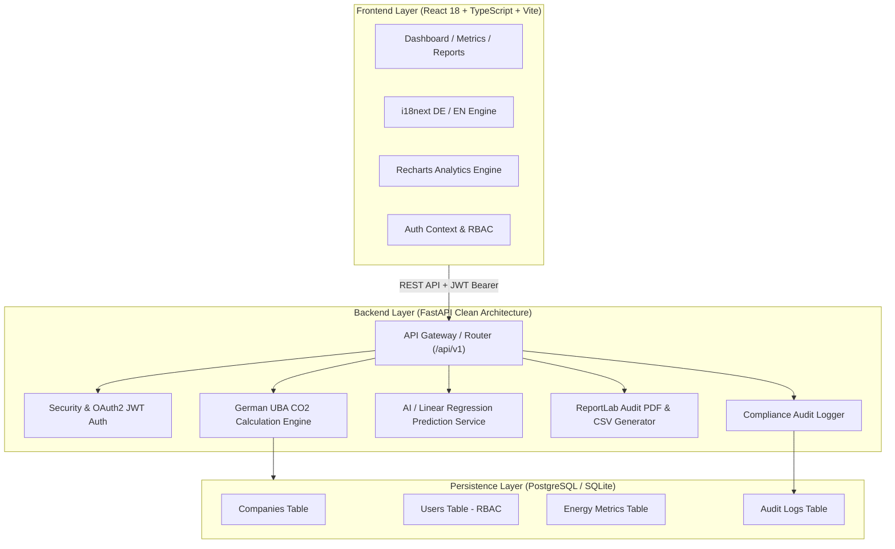

# EcoTrack – Smart Energy & Asset Management System
**Portfolio platform for German SMEs (KMU) | Carbon tracking demo with configured UBA factors**

[](https://github.com/nuraliyevumidjon242-hue/EcoTrack/actions)
[](https://fastapi.tiangolo.com)
[](https://reactjs.org)
[](https://www.typescriptlang.org/)
[](https://www.docker.com/)

---

[English project presentation](EcoTrack_Project_Presentation_EN.pptx)

> **Scope and security:** This is a portfolio/demo project, not a certification of legal or regulatory compliance. Demo accounts and seed data are for local development only. Docker Compose requires secrets from `.env` and does not create demo users in production.

## 🇩🇪 Projektübersicht (German Project Overview)

**EcoTrack** ist eine Full-Stack-Demo-Plattform für **deutsche kleine und mittlere Unternehmen (KMU / Mittelstand)**. Sie erfasst Verbrauchsdaten für Strom, Erdgas, Wasser und Abfall und berechnet geschätzte CO₂e-Werte anhand konfigurierter Beispiel-Emissionsfaktoren. Die Anwendung ist keine Bestätigung der Einhaltung von EU-Taxonomie- oder CSRD-Anforderungen.

### Kernfunktionen (Key Capabilities)
* **CO₂e-Schätzungen:** Umrechnung erfasster Verbrauchswerte (kWh, m³, kg) anhand konfigurierter Beispiel-Emissionsfaktoren.
* **Rollenbasierte Zugriffskontrolle (RBAC):** Rollen für `SYSTEM_ADMIN`, `COMPANY_MANAGER` und `DATA_AUDITOR`.
* **Audit-Logging:** Protokollierung ausgewählter Systemaktionen mit Zeitstempel, IP-Adresse und Benutzerkennung.
* **Verbrauchsprognose:** Lineare Regression über monatliche Verbrauchsdaten; bei wenigen Datenpunkten wird eine Demo-Baseline verwendet.
* **Berichtsexport:** PDF- und UTF-8-CSV-Exporte für die weitere Auswertung.
* **Vollständige Internationalisierung (i18n):** Dynamischer Wechsel zwischen Deutsch (DE) und Englisch (EN).

---

## 🏛️ Systemarchitektur (Clean Architecture)



---

## ⚡ Schnellstart & Lokale Ausführung (Getting Started)

### Option 1: Schneller lokaler Start (Development Mode)

#### 1. Backend starten:
```bash
cd backend
python -m venv venv
source venv/bin/activate  # Unter Windows: venv\Scripts\activate
pip install -r requirements.txt
pytest tests/ -v          # Unit- und Integrationstests ausführen
uvicorn app.main:app --host 0.0.0.0 --port 8080 --reload
```
* Backend API & Swagger Doku: `http://localhost:8080/docs`

#### 2. Frontend starten:
```bash
cd frontend
npm install
npm run dev
```
* Web-Anwendung: `http://localhost:5173`

---

### Option 2: Docker Compose (Production Setup)
Create a local `.env` file from `.env.example` and replace the `SECRET_KEY` and `POSTGRES_PASSWORD` placeholders with unique random 64-character hexadecimal values:

```bash
# PowerShell
Copy-Item .env.example .env

# Generate a random value; use a different value for each setting.
python -c "import secrets; print(secrets.token_hex(32))"
```

Keep `.env` private; it is excluded by `.gitignore`.

```bash
docker compose up --build
```
* **Frontend:** `http://localhost:3000`
* **Backend API Docs:** `http://localhost:8080/docs`
* **PostgreSQL:** `localhost:5432`

---

## 🔑 Demo-Zugangsdaten (Development/Test Only)

These accounts are seeded only when `ENVIRONMENT` is not `production`. Do not use these credentials for a deployed environment.

| Rolle | E-Mail | Passwort | Berechtigungen |
| :--- | :--- | :--- | :--- |
| **Manager (Geschäftsführer)** | `manager@mueller-tech.de` | `Password123!` | Voller Zugriff, Bearbeiten, Löschen, Exporte |
| **Auditor (Datenerfasser)** | `auditor@mueller-tech.de` | `Password123!` | Zählerstände erfassen, Berichte ansehen |
| **Admin (Systemadministrator)** | `admin@ecotrack.de` | `AdminSecret123!` | Plattformverwaltung, Globale Audit-Logs |

---

## 📊 Konfigurierte Emissionsfaktoren (Demo Values)

$$\text{CO}_2\text{-Emission (kg)} = \text{Verbrauchswert} \times \text{UBA-Faktor}$$

* **Strom (German Energy Mix Grid):** `0.380 kg CO2 / kWh`
* **Erdgas (Natural Gas):** `0.201 kg CO2 / kWh`
* **Frischwasser (Freshwater Supply):** `0.344 kg CO2 / m³`
* **Gewerbeabfall (Commercial Waste):** `0.450 kg CO2 / kg`

---

## 🧪 Testabdeckung & Qualitätssicherung

```bash
pytest backend/tests/ -v
```

* `test_uba_engine.py`: Validiert mathematische Genauigkeit aller UBA-Umrechnungen und Fehlerbehandlung bei Negativwerten.
* `test_auth.py`: Prüft JWT-Tokenausstellung, Kennworthash-Validierung und Rollenbeschränkungen.
* `test_metrics.py`: Testet den gesamten Lebenszyklus der Zählerstanderfassung, Revisionsprotokollierung und Dashboard-Aggregationen.

---

## License

No license file is included yet. Add one before redistributing or reusing this project.
